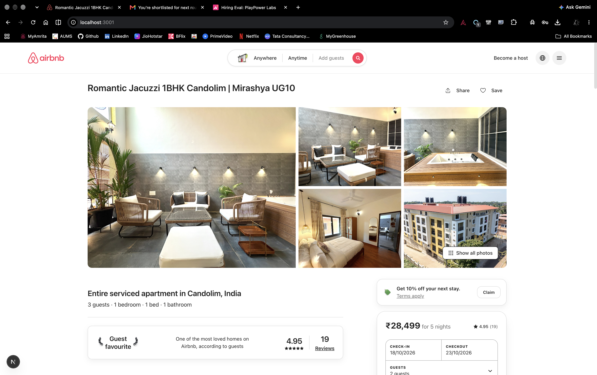
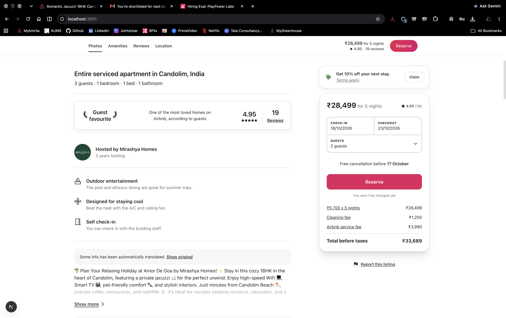
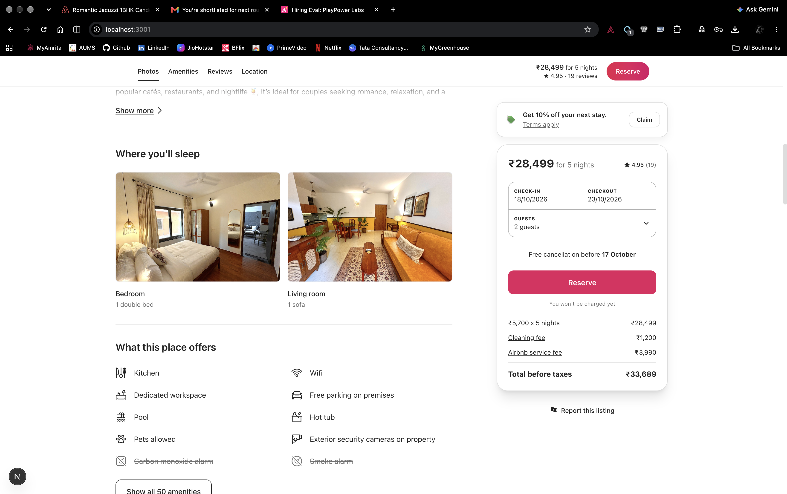
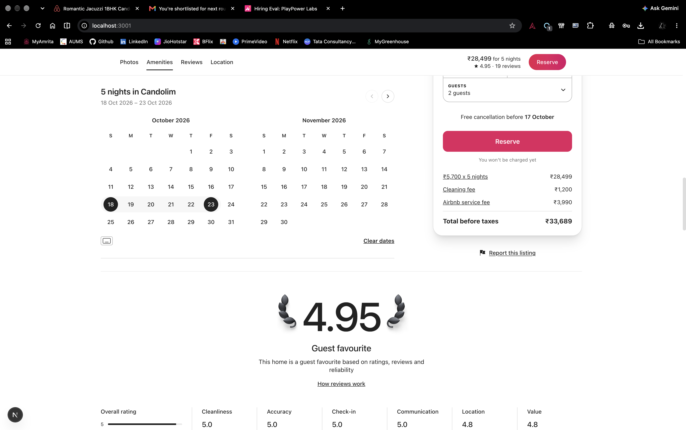
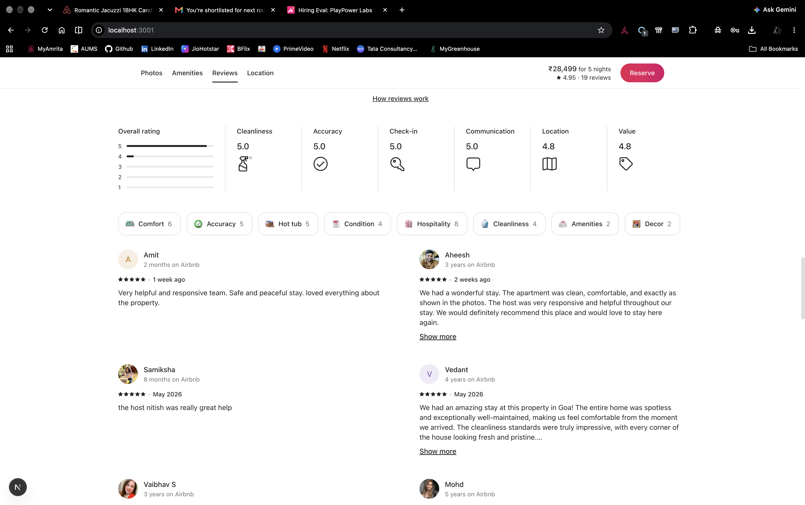
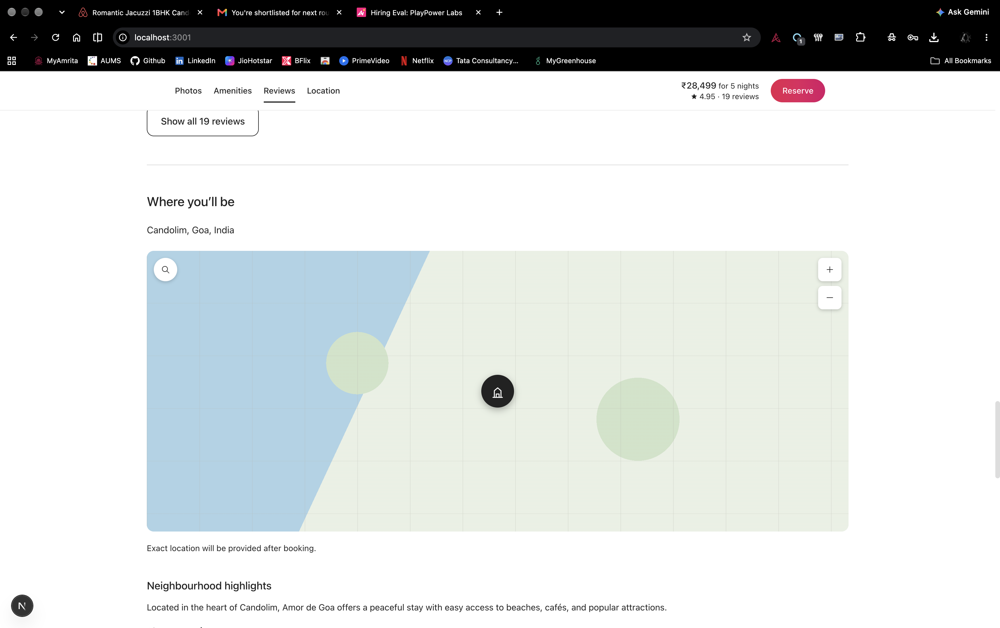
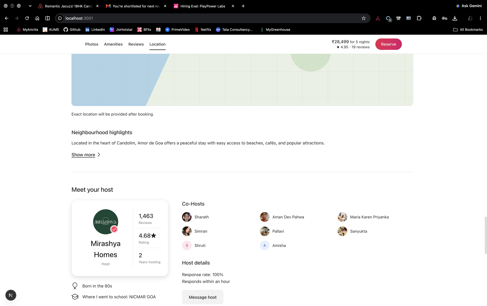
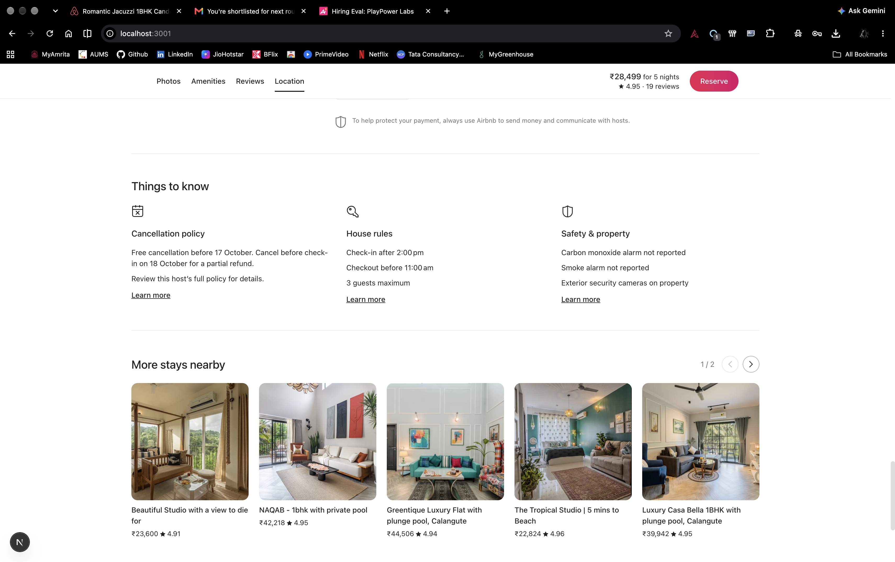
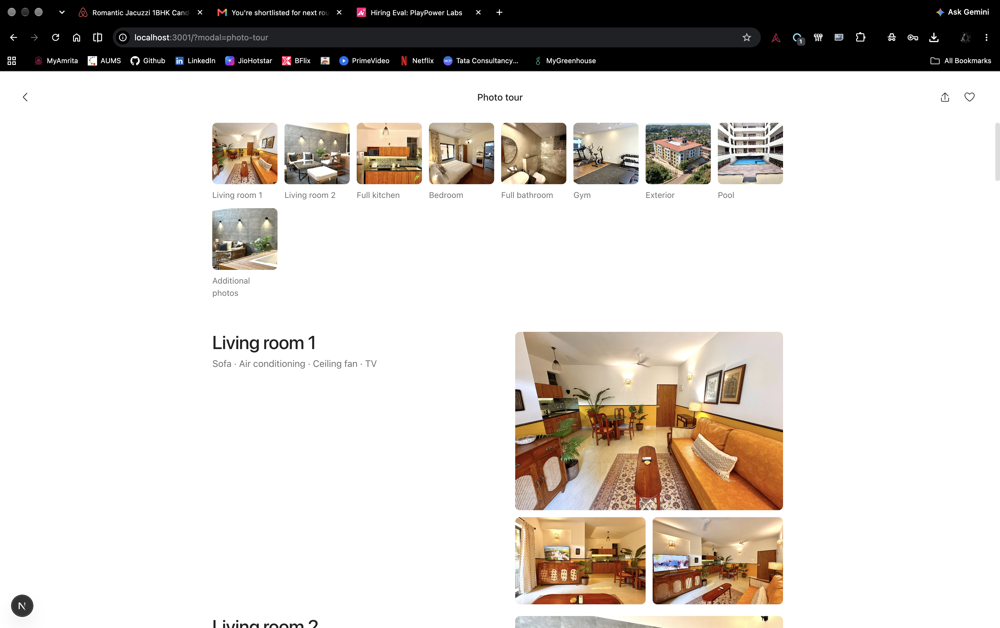
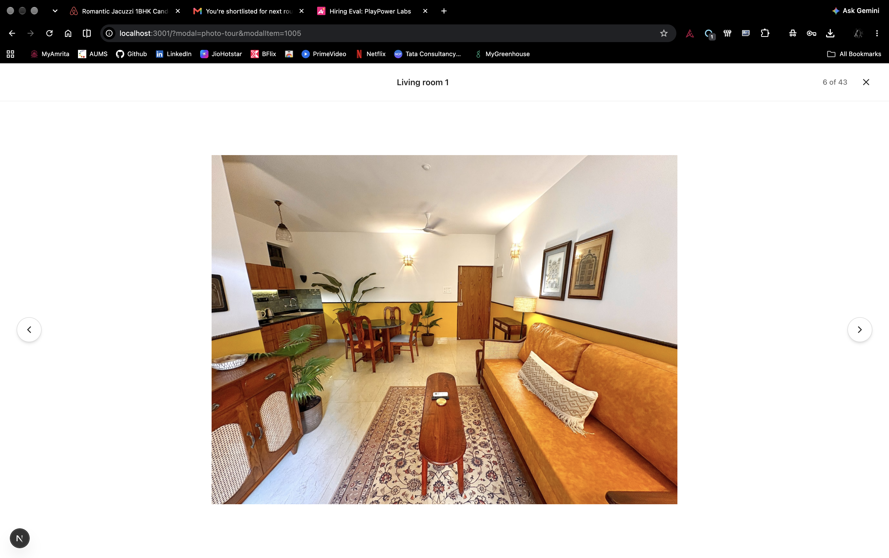

# Airbnb-Clone App & Production Architecture

> **Playpower Labs Take-Home Task Submission: Software Engineer**
> **Candidate**: Sheela Akshar Sakhi
> **Project**: Pixel-perfect clone of Airbnb Listing Page + Production-Scale Marketplace Architecture
> **Reference Listing**: [https://airbnb-clone-umber-two.vercel.app](https://airbnb-clone-umber-two.vercel.app)

---

## 🌟 Overview & Highlights

This repository contains:

1. **Pixel-Perfect Airbnb Clone**: Built with **Next.js 15+ (App Router)**, **React 19**, **TypeScript**, and **Tailwind CSS**.
   - **Listing Page**: Full property page matching exact layout, typography, colors, animations, and interactions.
   - **Photo Tour View**: Full-screen photo gallery overlay opened from "Show all photos" or hero images, with horizontal room thumbnail pills and smooth scrolling.
   - **Lightbox View**: Single-photo viewer with 9-dot grid icon, counter (`X of 43`), previous/next circular buttons, keyboard arrow controls (`←`/`→`), and `Escape` key close.
2. **Production-Scale Marketplace Architecture Diagram**:
   - High-level scaling architecture for a production-scale vacation-rental marketplace (think Airbnb).
   - Covers: Frontend CDN & Edge SSR, API Gateway, Microservices, Event-driven streaming (Kafka + Debezium CDC), Polyglot storage (Aurora PostgreSQL, MongoDB, Redis, Elasticsearch, S3), and Multi-Region Kubernetes deployment.
   - Deliverables: High-resolution architecture diagram (`architecture/architecture-diagram.png`) and comprehensive scaling strategy document (`architecture/production_scaling_strategy.md`).
3. **AI Subagent & Skill Configurations**:
   - Located in `subagent-config/` illustrating modern agentic workflows (QA audit, accessibility review, code standards).
4. **Sequence of Prompts**:
   - Documented chronologically in `ai-prompts/prompts.md`.

---

## 🚀 Quick Start (Running Locally)

### Prerequisites

- Node.js 18+ (tested on Node v20/v22)
- npm 9+
- Modern desktop browser (Google Chrome, Brave, Edge, Safari)

### Installation & Run

```bash
# 1. Install dependencies
npm install

# 2. Run the development server
npm run dev

# 3. Open in browser
http://localhost:3000
```

### TypeScript Verification

```bash
npm run typecheck
# or: npx tsc --noEmit (passes with 0 errors)
```

---

## 📸 Screenshots & Visual Parity

High-resolution desktop screenshots verifying visual and behavioral parity across all views:

### View 1: Main Listing Page (`/`)

The full property page matching layout, spacing, typography, colors, sticky sub-navigation, and interactions:



#### Additional Listing Page Sections (Top to Bottom):

- **Host Info & Apartment Highlights**:
  
- **Sleeping Arrangements & Amenities Grid**:
  
- **Interactive Calendar & Guest Favourite Rating Overview**:
  
- **Guest Reviews Breakdown & Reviews Cards**:
  
- **Interactive Location Map & Neighbourhood**:
  
- **Meet Your Host & Co-Hosts**:
  
- **Things to Know, Policies & Nearby Stays**:
  

---

### View 2: Photo Tour Modal (`/?modal=photo-tour`)

Full-screen categorized photo gallery opened from "Show all photos" or any hero photo:



---

### View 3: Single-Photo Lightbox Viewer (`/?modal=photo-tour&modalItem=1005`)

Full-screen single photo viewer with counter (`X of 43`), navigation arrows, and keyboard support (`←`/`→`/`ESC`):



---

## 🖥️ Screen Views & Behavioral Parity Details

### 1. Main Listing Page (`/`)

- **Navigation Header**: Airbnb brand logo, interactive search pill ("Anywhere | Anytime | Add guests" + red search button), "Become a host", language icon, and user menu dropdown.
- **Listing Title & Actions**: "Romantic Jacuzzi 1BHK Candolim | Mirashya UG10" with interactive **Share** (with copy-link modal) and **Save** (animated heart state).
- **Hero Photo Grid**: 5-photo collage with rounded corners, hover brightness effect, and anchored "Show all photos" 9-dot button.
- **Property Highlights**: Guest favourite laurel wreath badge (4.95 score, 19 reviews), host mini-summary with emerald initials badge.
- **Where You'll Sleep**: Visual bedroom & living room cards.
- **Amenities**: 10 categorized amenities with custom icons and "Show all 50 amenities" modal.
- **Interactive Calendar**: Dual-month calendar with selected 5-night range (18 Oct – 23 Oct 2026).
- **Reviews Breakdown**: Star distribution bars (92% 5-star), 6 category ratings (Cleanliness, Accuracy, Check-in, Communication, Location, Value), guest highlight tags, and 6 guest review cards.
- **Location & Map**: Stylized interactive map with Candolim coastline, location marker, and zoom controls (+/-).
- **Meet Your Host**: Full profile card for Mirashya Homes with Superhost badge, stats, co-hosts list, and message button.
- **Sticky Booking Card**: 10% promo claim banner, price calculation (₹28,499 for 5 nights), guest selector dropdown (Adults, Children, Infants, Pets), and Reserve button.

### 2. Photo Tour Overlay (`/?modal=photo-tour`)

- Full-screen modal overlay (`role="dialog"`, `aria-modal="true"`) with locked background scrolling.
- Sticky top bar with back chevron (`←`), "Photo tour" heading, and Share/Save buttons.
- 9 room category thumbnail navigation pills (Living room 1, Living room 2, Full kitchen, Bedroom, Full bathroom, Gym, Exterior, Pool, Additional photos) that smoothly scroll into room sections.
- Clicking any photo opens the Lightbox focused on that specific photo ID.

### 3. Lightbox Single-Photo Viewer (`/?modal=photo-tour&modalItem=[photoId]`)

- Single-photo modal viewer with clean white backdrop.
- Top bar with 9-dot grid icon (returns to Photo Tour grid), room label, photo counter (`X of 43`), and close (✕) button.
- Left and right circular navigation buttons with smooth fade photo transitions.
- Full keyboard support:
  - `ArrowLeft`: Previous photo
  - `ArrowRight`: Next photo
  - `Escape`: Close viewer
- Focus trap and focus restoration.

---

## 🏛️ Production Architecture Deliverables

The architecture diagrams and detailed scaling strategy are located in the `architecture/` directory:

- **`architecture/architecture-diagram.png`**: High-resolution architecture diagram illustrating global edge CDN, API Gateway, microservices layer, Kafka event streaming, polyglot storage, and Kubernetes infrastructure.
- **`architecture/production_scaling_strategy.md`**: In-depth scaling analysis across frontend, backend, storage, search, and deployment.

---

## 📁 Repository Structure

```
Airbnb-Clone App/
│
├── app/                              # Next.js App Router (page.tsx, layout.tsx, globals.css)
├── components/                       # Modular UI Components
│   ├── Header.tsx                    # Main header with brand & search bar
│   ├── TitleSection.tsx              # Title, share, and save actions
│   ├── HeroGallery.tsx               # 5-photo hero grid
│   ├── ListingInfo.tsx               # Property overview & host summary
│   ├── SleepingArrangements.tsx      # Where you'll sleep cards
│   ├── AmenitiesSection.tsx          # Amenities list & modal
│   ├── CalendarSection.tsx           # Dual-month interactive calendar
│   ├── ReviewsSection.tsx            # Rating bars & review cards
│   ├── LocationMap.tsx               # Interactive map & neighbourhood
│   ├── HostBio.tsx                   # Meet your host profile & co-hosts
│   ├── ThingsToKnow.tsx              # House rules & cancellation
│   ├── NearbyStays.tsx               # More stays carousel
│   ├── BookingWidget.tsx             # Sticky reservation card
│   ├── PhotoTourModal.tsx            # Full-screen photo tour
│   ├── LightboxModal.tsx             # Single-photo viewer
│   ├── Footer.tsx                    # Airbnb footer
│   └── Icons.tsx                     # SVG icon library
├── data/
│   └── listingData.ts                # Strongly-typed listing dataset
├── public/                           # Static assets & images
│
├── screenshots/                      # 10 Retina high-resolution screenshots
│   ├── listing-page.png              # View 1: Main Listing Page
│   ├── listing-page-host-details.png # Listing Page: Host & Highlights
│   ├── listing-page-sleep-amenities.png # Listing Page: Where you'll sleep & Amenities
│   ├── listing-page-calendar.png     # Listing Page: Availability Calendar & Ratings
│   ├── listing-page-reviews.png      # Listing Page: Reviews & Rating Breakdown
│   ├── listing-page-location.png     # Listing Page: Map & Neighbourhood
│   ├── listing-page-meet-host.png    # Listing Page: Host Card & Co-hosts
│   ├── listing-page-things-to-know.png # Listing Page: House Rules & Nearby Stays
│   ├── photo-tour.png                # View 2: Photo Tour Modal
│   └── lightbox.png                  # View 3: Lightbox Viewer
│
├── architecture/                     # System design deliverables
│   ├── architecture-diagram.png      # High-res architecture diagram
│   └── production_scaling_strategy.md # Full scaling strategy
│
├── ai-prompts/
│   └── prompts.md                    # Chronological AI prompts log
│
├── subagent-config/                  # AI subagent & skill configurations
│   ├── README.md
│   ├── AGENTS.md
│   ├── subagents/
│   │   └── visual-parity-checker.md
│   └── skills/
│       ├── airbnb-qa/SKILL.md
│       └── code-review/SKILL.md
│
├── instructions.txt                  # Quick setup instructions (Plaintext)
├── instructions.md                   # Quick setup instructions (Markdown)
├── README.md                         # Project documentation
├── package.json                      # Project dependencies & scripts
├── tsconfig.json                     # TypeScript configuration
└── next.config.mjs                   # Next.js configuration
```


